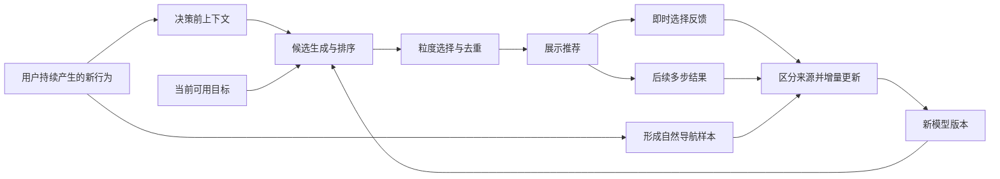

# SmartApp：上下文序列与主动目标推荐

> 当前实现覆盖：新会话只采集前台到达，不再读取或保存后台应用、窗口、标签页、窗格或候选库存；运行时只使用 `shared-online-path-mlp-v1` 一套在线学习模型，旧模型不再参与运行。本文是 2026-09-17 的设计记录，凡与当前边界冲突处均为历史方案，不得据此恢复后台采集。请以 [数据格式](DATASET.md) 和根目录 `AGENTS.md` 为准。

设计记录，2026-09-17。用户已确认先实施采集试验，v0.2 已按本方案的首轮范围实现并安装。本文保留建模和后续交互建议；当前已实现的字段、覆盖范围与限制以 [v2 数据格式](DATASET.md) 为准，实测结果见 [v2 验证记录](COLLECTION_V2_VALIDATION.md)。旧轨迹数据库独立保留。

## 已确定的方向

- 推荐范围扩展为应用、网站/网页、已打开窗口以及本地目录/文件。窗口与标签页可作为具体目标已经打开的入口；应用内部的会话、功能页面等暂不纳入。
- 输入包含当前活跃应用和网站、此前活跃窗口的顺序、最近剪贴板中的文件/数据类型。保留有时间顺序的前置上下文，不能只有当前应用快照。
- 鼠标晃动是主动唤出入口。原始轨迹不进入持久化训练数据，也不作为应用预测特征。
- 剪贴板正文先不采集，页面正文不纳入当前方案。网站级信息以域名表达；具体网页与本地目标的定位信息需要单独确定。
- 一次窗口切换可能只是中间步骤，后续窗口、标签页和网页变化也要记录。数据保留多步序列，可能的最终目的地单独推断。
- 推荐粒度随置信程度调整：具体目标可信时优先推荐标签页、文件等；具体项不确定但相关窗口或目录可信时，推荐该通用入口。
- 算法方向优先采用个性化推荐架构，同时利用用户自然产生的新行为和推荐后的反馈进行在线增量学习；未唤出菜单时也能学习，具体模型尚未确定。
- 当前阶段先采集真实使用数据；菜单暂用近期使用排序，在线学习与置信度模型尚未启用。到达方式不作为采集对象，不记录键盘、快捷键、点击或启动器搜索正文。

## 首版采集清单（建议）

采集围绕三个问题展开：当时有哪些目标可选、用户实际按什么顺序到达哪些目标、推荐展示后发生了什么。前五类随正常使用积累，第六类只在推荐交互发生时产生。

| 数据 | 最小记录内容 | 时机与用途 |
| --- | --- | --- |
| 前台活动时间线 | 应用、窗口、活动标签页及网站/页面标识，能可靠识别的目录/文件目标；变化时间与事件来源 | 激活、切换或导航时记录，保留前后多步；后台页面更新不当作用户访问 |
| 目标身份与关系 | 目标 ID、类型、应用 Bundle ID、会话内窗口/标签页 ID；页面与标签页、标签页与窗口、文件与目录及打开入口的关系 | 发现或关系变化时登记，关系带生效时间；用于精确推荐、入口选择、去重与粒度回退 |
| 当时可用的目标 | 当前打开的应用/窗口/标签页，以及已知且允许推荐的未打开应用、近期/固定目标；发现、打开、关闭、导航、失效等变化 | 初始快照加后续变更，必要时重新同步；恢复任一自然样本或推荐决策之前已知的候选，不能用今天的列表替代过去状态 |
| 剪贴板元数据历史 | 观察到的新版本、变化时间、文本/网址/图片/文件等类型、可获得的具体文件格式、观察时前台应用 | 每次观察到新版本记录一次；不记录正文或从剪贴板提取文件路径，不推定复制来源 |
| 时间与观测边界 | 时间戳、时区、采集会话、暂停/恢复、锁屏/休眠、排除与数据源中断；可获得时的粗粒度空闲/恢复状态 | 标出历史缺口，避免将不可观察区间或离开电脑一律计作有效使用；空闲也不等于用户没有阅读 |
| 推荐曝光与反馈 | 仅实际选择的会话保存唤出时间、输入截止点、候选及实际展示顺序、目标与入口、具体/通用粒度、分数和模型/策略版本、执行结果和后续事件引用 | 每次已选择的推荐交互关联同一个 decisionID；未选择关闭的会话在内存中丢弃，不要求保存搜索输入正文 |

每个事件应有唯一 ID、事件时间（可获得时）、观察时间、会话内顺序、数据源及格式版本；无法观察的身份或状态明确记缺失。能关联推荐时保留 decisionID，来源不明时不猜测。一个真实事件只保存一次，前置历史和后续结果通过时间范围引用，不反复复制整段历史。

页面/文件定位信息是实施前仍待确认的部分：域名足以学习网站级偏好，会话内标签页 ID 可区分当前入口，但不能独自作为跨会话网页身份；文件格式也不能区分具体文件。建议在本地目标目录中单独管理经允许的可打开定位信息，事件日志引用目标 ID。窗口/页面标题可另行评估，不作为首版身份识别的必要字段，也不默认采集。仅给敏感定位信息换成 ID 并不消除其本地映射中的内容。

停留时长、最近使用时间、使用频率、转移概率、连续返回次数、星期/时段和多步目的地标签由上述事实派生，保留规则版本即可重算；不需要再采集一套重复数据。用于历史样本的统计只计算到该样本截止时刻。在线训练启用后另记消耗的样本 ID、训练任务与模型版本，避免重复更新；这属于训练审计，不是新增用户行为采集。

记录粒度以有意义的状态变化为主。合并重复通知时保留真实的短暂切换与导航，不因为停留短就删去中间步骤。鼠标轨迹、逐键输入、点击坐标、截图、页面/文件正文、剪贴板正文及其他应用内部业务动作不列入首版训练数据。

## 真实场景检查与补充建议

用户提出以下场景作为方案检查依据。它们说明当前数据方向可以支持基础推荐，但只使用当前应用、域名和固定五分钟历史不足以覆盖所有目标粒度；实际效果仍需连续使用数据验证。

| 场景 | 可以利用的观察 | 需要保留的区别或限制 |
| --- | --- | --- |
| 上课时打开录音软件，再切换到 ChatGPT | 星期/时段、录音应用启动或访问、此前的课程页面/笔记及历史重复模式 | 录音应用出现后可以形成条件线索；若尚无可观察的课程线索，只能依赖习惯，不能声称已知道用户在上课。打开应用不证明正在录音 |
| 晚上工作时打开音乐，再返回工作 | 时段、这一段工作的已知目标、音乐应用最近访问及当前是否运行 | 短暂访问音乐不应自动重置工作上下文；停留短不能直接作为推荐失败。正在运行不等于正在播放 |
| 作业页面与 GPT 页面往返 | 两个具体目标的身份、切换方向、连续返回、当前活动片段中的使用记录 | 域名不能区分同一网站内的多门课或多份作业；反复切换可形成多目标工作过程，不必强行指定唯一终点 |
| 笔记与作业往返 | 笔记应用/窗口、作业页面及可获得的本地文档身份 | 能识别独立文件时可推荐文件；若笔记条目是应用内部对象，则仍只推荐应用/窗口，符合当前范围 |
| GPT 客户端与网页端切换 | 原生应用/窗口与浏览器标签页分别记录，保留前后序列 | 同一服务不代表同一个目标，不能仅按服务名合并；不假设两端展示同一会话，也不新增客户端内部会话采集 |
| GPT、GitHub 与开发中的 Web 页面切换 | 页面身份、允许范围内的仓库/项目定位、开发站点的协议/主机/端口、近期共同使用关系 | 只记 github.com 或 localhost 会丢失差异；端口也不是永久项目 ID，复用端口或不同项目共享域名时应保留不确定性 |

据此建议补充三点，均先作为方案，尚未扩展实际采集：

1. **保留比最近几步更长的活动上下文。** 从已有时间线中生成这一段学习/工作的目标集合、反复返回情况和关键启动事件，作为短期序列与长期习惯之间的一层。短暂的音乐访问或其他插入动作不自动创建新任务。活动范围和摘要方法需实验，不能简单把两个小时内的所有目标都判成同一任务。
2. **细化目标身份，但仍区分身份与正文。** 支持具体网页时，需另行确定允许的页面标识和打开定位；本地开发站点至少不能在域名层抹掉端口差异。协议/主机/端口只是站点区分依据，不足以识别永久项目或具体页面。路径、必要的查询/路由字段和仓库/课程分组的允许规则待定，不默认保存完整 URL 或标题。HTTP(S) origin 的组成可参见 [WHATWG URL Standard](https://url.spec.whatwg.org/#origin)。
3. **将关系分成身份、包含和共同使用。** 同一资源的不同打开入口可以去重；标签页属于窗口、文件属于目录可以用于回退；经常一起使用或属于同一服务的两个目标仍可分别推荐。共同使用关系从截止时刻之前的日志推导，并保留权重与推导版本，不能当作固定事实或对象等价关系。

“上课”“做作业”“开发”等名称可作为解释或将来的可选标注；首版不要求先训练准确的场景分类器才能排序，也不需要为此新增日历、地点、麦克风或正文采集。相同的可观察输入可能对应不同的真实意图，应允许多个候选并保持不确定性。这些场景中剪贴板类型是辅助信号，不一定能区分作业、课程与开发任务。

录音是否进行、音乐是否播放属于更细的应用状态，本轮仍不纳入；若以后单独扩展，状态可用性和可靠性也要记录。当前只能使用运行与前台访问记录，不能因此承诺避免所有重复推荐，也不应因应用正在运行就把它排除。

上述使用过程可能长期在多个目的地之间往返。多步标签因此保留各目标、到达顺序和时间，不强行压成唯一最终目的地；打开音乐后快速回到作业也可能是有用结果。第一版检验重点是：相同 GPT 目标在不同历史下能否得到不同排序、短暂插入动作后能否恢复之前目标、原生/网页端是否误合并、域名相同但资源不同是否可区分、较久之前的关键事件是否仍能发挥作用。

结合当前活动与跨活动历史的推荐研究可参见 [Personalizing Session-based Recommendations with Hierarchical Recurrent Neural Networks](https://arxiv.org/abs/1706.04148)。该研究提供建模参考，不证明这些桌面场景已经有效，也不决定本项目必须使用其模型或固定会话边界。

## 产品流程

## 目标对象与打开入口

目标对象与入口分开记录，同一目标可以关联多个打开入口。

| 目标对象 | 对象身份 | 可用入口 |
| --- | --- | --- |
| 应用 | 应用 Bundle ID | 已运行实例或启动应用 |
| 网站/网页 | 网站域名，或经允许的具体页面定位信息 | 现有浏览器标签页，或打开地址 |
| 本地目录 | 经允许登记或自动观察的目录定位信息 | 已有 Finder 窗口、QSpace Pro 窗格，或按保存地址打开目录 |
| 本地文件 | 经允许登记的文件定位信息 | 已有文档窗口，或打开文件 |
| 通用窗口 | 所属应用与会话内窗口标识 | 激活该窗口；内容不可识别时不猜测对象 |

已有浏览器标签页属于入口层，需关联浏览器、窗口、标签页及其当时实际页面。没有已打开的入口也可以存在目标。页面导航后更新入口关联，不能一直沿用窗口首次激活时的标签页内容。

目标身份不能统一简化为 Bundle ID，也不能把标题相同的两个窗口视为同一个对象。同一对象经不同入口到达时保留具体入口选择，推荐时可以按实际语义去重。

桌面 Space 是工作区，建议留作扩展；桌面文件夹属于目录，“显示桌面”属于系统操作。浏览器标签页和网页导航属于当前讨论范围，其他应用内部的会话、按钮或业务动作暂不采集。

例如，同样停留在浏览器中，“github.com → 编辑器 → github.com”和“在线文档网站 → Preview → 剪贴板出现 PDF 文件”具有不同的上下文。应用、网站、窗口之间的顺序与停留时间可以成为区分信号；是否有效仍需数据验证。此处不依赖报错文本、论文内容或剪贴板正文。

## 上下文的四个时间范围（建议）

以下时长和数量是可调整的首轮实验参数，不是已验证的最优值。

| 层次 | 建议保留的信息 | 用途 |
| --- | --- | --- |
| 当前状态 | 前台应用、当前窗口标识、活跃网站域名、正在运行的 GUI 应用、当前时间、最近剪贴板类型 | 描述唤出菜单前的现场 |
| 近期序列 | 最近 5 分钟内最多 30 次窗口/网站激活与剪贴板类型变化，及其时间间隔、停留时长 | 表达用户此前的工作过程 |
| 当前活动片段 | 从更长历史派生的相关目标集合、关键启动/访问事件与反复返回情况，摘要规模有界且可随活动变化 | 在短暂插入动作后仍保留课程、作业或开发过程的上下文；不要求有确定的任务名称 |
| 长期习惯 | 各目标使用频率、最近使用时间、目标间切换与共同使用关系、按星期及时段的偏好 | 冷启动后的个人排序与先验 |

训练数据连续保留事件时间线，再按时间区间生成样本。一次窗口激活或推荐选择不会终止后续记录。每条记录同时包含事件时间、观察时间和来源，不能获取的字段明确记为缺失。

五分钟/三十次只限制首轮短期序列实验，不作为全部上下文的硬边界。活动片段及长期统计从此前可观察日志生成，属于派生特征；事后才出现的目标或任务分组不能倒填到先前输入。同一时段可能同时有学习、录音和音乐等活动，不强制使用单一互斥的场景标签。

长时间停留用“停留多久”表达，不为保持长度重复保存同一页面。跨锁屏、暂停、排除应用或观察中断的历史需要显式边界，不能伪装成连续工作流。

## 有意义的状态变化

| 事件 | 建议字段 | 记录时机 |
| --- | --- | --- |
| 应用切换 | 原应用、新应用、前一应用停留时间、运行应用集合变化 | 前台应用发生变化 |
| 网站/窗口变化 | 所属应用、会话内窗口标识、活跃网站域名、可获得的标签页标识、允许范围内的页面标识、进入/离开时间 | 活动窗口、标签页或页面导航变化；身份不可获得时保留缺失 |
| 剪贴板变化 | 可用数据类型、可获得的具体文件格式、变化时间、距唤出多久、当时观察到的前台应用 | 检测到新的剪贴板版本 |
| 可用性变化 | 暂停/恢复、排除、权限缺失、锁屏或休眠 | 状态发生变化 |
| 已选择的推荐会话 | 原唤出时间、输入历史的截止时间、上下文记录 ID | 用户实际选择一个目标时提交；未选择关闭不落盘 |
| 推荐反馈 | 候选顺序、模型版本、推荐粒度、关联父目标与回退依据、选择项、选择方式、执行结果、关联的后续事件 | 已选择的展示、选择与后续目标变化 |

相同窗口/网站状态去重，快速变化做合并。同一剪贴板版本只记录一次；即使两次都是 PDF 类型，版本变化仍应保留为两个事件。不要逐帧保存页面或逐键保存输入。

窗口顺序指用户实际激活窗口的时间顺序，包含同一应用的不同窗口。使用会话内稳定的窗口标识来区分它们，不依靠窗口标题或文件路径做标识；标签页标识不可用时记缺失，不能把两个同域名标签页擅自当成同一页面。

剪贴板变化时的前台应用只是观察信息，并不保证是复制来源；跨设备剪贴板和后台程序都可能改变内容。不把剪贴板变化直接标成“已复制”，也不把它自动标成“已粘贴”。

网站采集覆盖前台浏览器的活动标签页，窗口激活后继续观察标签页切换和页面导航。当前域名信息只能分辨网站级变化，同域名的不同页面需要页面标识或经允许的地址信息，不能宣称仅靠域名就已支持精确网页预测。具体页面定位范围尚待确认，本轮不新增 URL 或正文采集。

需要浏览器适配；窗口与标签页属性不可用时降级。浏览器激活时显露出原有标签页，只说明它被呈现，不能据此认定用户主动选择了这张网页。能可靠关联的容器激活和页面显露应归入同一步并保留原始事件，不凭空推断操作原因。窗口标题不是区分窗口身份的必要条件。

剪贴板类型包括文本、网址、图片、文件引用等；文件引用尽量通过系统可用的类型元数据细分为 PDF、PNG、源代码文件等。不保存文件名、文件路径或文件内容。系统只提供“文件”时就保留较粗的类型，无法识别时记未知，不为补齐类型而扩大正文读取范围。

## 数据组合与保存范围

应用、网站、窗口历史和剪贴板类型是可以组合的不同信息来源。历史时间跨度是另一个维度。正文、摘要或向量才属于内容保存形式，不应混成互斥的三选一。

首版组合为：**应用与网站状态 + 窗口激活顺序 + 停留时长 + 剪贴板类型历史**。不采集剪贴板正文，不生成依赖剪贴板正文的摘要或向量，也不声称仅凭“文本类型”就知道是代码、地址还是普通文字。

同样的原则适用于页面：先保留站点与窗口关系；若希望推荐同一网站的具体页面，需要明确页面定位字段，仍不默认扩展为正文采集。目标目录/文件的定位信息与剪贴板数据分开设计，不能为了收集剪贴板文件类型而顺带保存路径。

本地事件日志的保留天数可单独设置；用于一次推荐的五分钟上下文窗口，并不等于日志仅保存五分钟。保留天数仍需在实施前确定。

缺少允许、进入排除来源或系统不提供信息时，记录缺失原因并继续使用可用信号。本轮只设计字段，没有读取页面正文或剪贴板内容，也没有新增这些权限。

## 怎样得到训练标签

保留两条数据来源，并且区分它们：

1. **自然导航**：用户正常操作时，以某个决策时间之前已观察到的历史为输入，保留之后的应用、窗口、标签页和目标对象变化序列，以及停留时长和间隔。一次导航过程不要因多次上下文更新被重复放大。
2. **主动推荐会话**：晃动鼠标时固定输入历史，记录展示的全部候选和排序、用户实际选择、打开是否成功，以及后续多步实际导航。搜索找到未推荐的目标，也是一条有用反馈。

推荐影响了用户的选择，因此自然切换和推荐选择不能混成同一种无偏标签；保留 `origin` 与模型/候选信息，分别评估。

训练样本的基本单位是：

> 决策前的上下文事件序列 + 当时可用的个人习惯 → 后续实际经过的目标序列 + 可选的目的地候选标签。

上下文截止点必须早于待预测的后续变化。不能先到达目标，再读取其地址、标题或运行状态并填回该样本输入。SmartApp 自身弹出的菜单和面板也不应覆盖原任务上下文。

未选择即关闭的推荐菜单整次在内存中丢弃：不记录候选、不将其视为反例，也不把随后导航关联为推荐结果。观察中断或会话结束时尚未形成足够证据，目的地标签记为未知。旧版“输入后两秒未切换就标为 __stay__”不能直接搬进新的主动推荐任务。

## 多步结果与目的地推断

示例：

> 编辑器 → Chrome 窗口（显露原有新闻页）→ GitHub 标签页 → 某个 Issue 页面 → 持续停留。

此时，“Chrome 窗口”是观测到的下一步，“新闻页”可能只是随窗口显露的内容，“Issue 页面”是一个可能的目的地。采集层保留全部观测及其时间关系，不提前把三者折叠为一个已确认意图。

每个样本保留以下不同层次：

| 结果层次 | 内容 | 性质 |
| --- | --- | --- |
| 下一步 | 首个实际观察到的目标/入口变化 | 观测事实，可用于简单基线 |
| 后续序列 | 多次目标、入口和页面变化及停留时间 | 观测事实，保留中转和返回 |
| 可能目的地 | 从后续序列中提出的候选、依据与规则版本 | 推断标签，可以缺失 |
| 明确选择 | 用户在推荐菜单中点选的对象 | 明确行为，但仍不等同于整个任务的最终目标 |

建议在导出/训练阶段比较后续 3–5 次有效变化、10 秒/30 秒等不同观察范围。这些只是实验窗口，采集本身持续进行；达到步数或时间上限不意味着最后一项就是终点。

停留时间、反复返回、菜单明确选择等可作为目的地候选证据。单纯停留久可能是离开电脑，快速切换也可能已完成任务，因此不使用单一时间阈值定义真实意图。多个目标之间来回工作的过程允许存在多个候选，证据不足保留未知。

“有效变化”的定义应能把一次窗口激活连带的内容显露与真正的后续导航区分开；不可观察的步骤保留缺口，不补造事件。推断标签需可追溯到原始事件，后续能够换规则重新生成。

产品主要尝试推荐有用的目的地，下一步与多步序列作为辅助训练和评估目标。是否直接到达某个候选，仍由用户在菜单中选择；记录多步结果不会授权系统自动执行整串操作。

## 推荐候选从哪里来

- 当前已打开的应用、窗口与浏览器标签页。
- 在允许范围内、决策时已知的近期访问目标、常用目标及用户固定的目标；它们可能当前没有打开。
- 搜索入口用于未被推荐或尚不可预测的目标。

如果只枚举当前窗口与当前标签页，推荐范围无法覆盖之后新打开的网页或目录。因此候选生成与历史采集需要单独设计，同时记录每次推荐时实际可用的候选集合。

某个具体地址第一次出现在后续序列中时，不能把它倒填进决策前的候选集合。评估同时报告候选覆盖率与覆盖范围内的排序命中率，避免把事后才知道的目标当成当时可预测的目标。

## 按置信程度决定推荐粒度

用户确认的原则：标签页、文件等具体目标可信时优先推荐具体项；具体项不确定时，考虑相关窗口或目录这样的通用入口。

| 判断 | 推荐结果 |
| --- | --- |
| 很有把握是窗口中的某个具体标签页 | 直接推荐该标签页/网页 |
| 很有把握需要这个浏览器窗口，但分不清其中的标签页 | 推荐该窗口 |
| 很有把握是目录中的某份文件 | 直接推荐该文件 |
| 很有把握需要这个目录，但分不清其中的文件 | 推荐该目录 |
| 具体目标与其窗口/目录都缺乏证据 | 不把父目标包装成高置信推荐，使用有明确来源的近期/常用目标或搜索入口 |

这些关系来自已知的实际关联：标签页所在窗口、文件所属目录、资源已有的打开入口。它们不一定组成一棵树；同一文件可能有多个窗口，一个窗口也可能展示多个对象。尚未打开的网页不能被随意归到当前某个浏览器窗口。

具体规则：

1. **先判断通用方向，再决定细化程度。** 分别评估父目标是否有用，以及是否有足够证据在它的子目标之间做选择。具体项分数低，不意味着父目标自动可信。
2. **选择最具体且仍可信的层级。** 具体项需有足够历史支持，并与其他候选有可用的区分证据；达不到条件时，在有依据的关联目标中回退。避免退到根目录等过于宽泛、没有实际帮助的入口。
3. **同一目标链默认占一个主要推荐位置。** 高置信文件已展示时，不再让它的目录和承载窗口重复占据主推荐位；需要时可提供次级的“打开所在位置”入口。不同的具体目的地仍可并列。
4. **排序分数与置信度分开。** 早期规则/频次分数不直接当作概率。使用按时间划分的验证数据评估各类型与粒度的可靠性，再确定细化与回退阈值；不预先固定一个适用于所有目标的百分比。
5. **不直接累加重叠分数。** 父目标覆盖范围更广，不能只因为分数更大就永远压过具体目标。多个入口可能指向同一对象，多步序列也可能包含多个相关目标；未经去重与一致定义的子项分数不能相加后称为父项置信度。
6. **目标可达性独立检查。** 目标具体且可信但尚未打开时，可以采用“打开”入口；已失效的窗口、标签页或文件定位应失效处理，不把执行失败伪装成模型不确定。

每次实际选择后才保留该次展示的决策目标关联、选择粒度和依据，后续才能分别回答：是否推荐对了方向、是否细化过头、是否回退过宽。原始模型分数与校准后的可靠性分开记录，未经校准时不在界面展示置信度百分比。

## 晃动与菜单交互

- 晃动检测仅在内存中维护很短的方向变化信息；允许幅度/速度阈值和冷却时间，拖拽时不触发。菜单未选择即关闭时，唤出及候选一并丢弃；实际选择时才持久化会话。
- 推荐显示在指针附近并限制在当前屏幕内；菜单打开时先固定来源上下文，避开把 SmartApp 误当成预测输入。
- 首轮建议展示 4 个目的地候选，以及搜索入口；支持鼠标点击、方向键与回车选择，Esc 或点击外部关闭。
- 菜单打开期间固定候选顺序，不因新数据或计数刷新把项目移到鼠标下方。点击才执行，不用悬停触发启动。
- 按已确定的推荐粒度展示目标名称与必要的来源信息：文件可附所在目录，标签页可附浏览器/窗口；相关父目标默认不重复占据主推荐位置。
- 推荐证据不足时展示近期/常用目标，并用真实来源说明排序，不展示未经校准的置信度百分比。
- 提供备用快捷键和菜单栏入口，便于不用鼠标的人操作。若需排查误触，只能使用不含目标或上下文关联、不可导出的短期聚合诊断。

此前的悬停空白问题尚未完成定位和修复。新菜单实现时需单独验收文字、高亮、打开面板、搜索、关闭和启动动作，不能仅凭改用某个 UI 框架就宣称问题解决。

## 推荐架构与在线学习

这里的“在线”指新的行为样本或推荐反馈到来后增量更新个人模型，整个过程可以在本机运行。实时构建上下文、实时执行推断和在线更新模型分别设计。

### 两条学习来源

| 来源 | 产生条件 | 学习内容 |
| --- | --- | --- |
| 自然行为流 | 采集开启后，用户正常切换应用/窗口、访问网站、进入允许记录的目录或文件等，无需唤出菜单 | 上下文与后续多步目标之间的关系、习惯变化、近期工作重点 |
| 推荐交互流 | 菜单实际展示且用户选择目标后，以及后续导航 | 展示顺序、推荐粒度与实际选择/使用结果之间的关系；未选择关闭不形成此类数据 |

自然行为同样能够生成增量训练样本。例如用户最近经常经历“项目网站 → 项目目录 → 某份文档”，即使从未使用推荐菜单，也能在观察到足够后续结果后更新相应的序列偏好。具体目的地仍按前文规定保留推断依据，不把观测顺序直接解释为已确认意图。

同一批新行为会驱动两种不同更新：一是立即刷新当前上下文、目标目录和使用统计；二是在样本结果可用后更新模型参数。只有状态缓存发生变化时，不能宣称模型已经学习了该行为。

两条来源可以共享事件日志、上下文表示和排序模型，也可以使用不同训练任务或权重；是否共用模型属于后续实验选择。两条来源不代表必须训练两个完全独立的模型。

推荐之后的用户行为可能受到展示内容影响，要保留关联的 `decisionID` 与来源信息，不能再把它当成一份独立、未受推荐影响的自然样本。一个真实事件只记录一次；若明确用于两个训练任务，需要分别标记任务与权重，而非无意重复强化同一次行为。来源不确定时如实记录未知。

建议拆分为以下组件：

| 组件 | 职责 |
| --- | --- |
| 目标目录与候选生成 | 维护当前可用及历史已知目标、打开入口与层级关系，选出本次可推荐的候选 |
| 上下文表示 | 将决策前的近期序列、当前状态和历史习惯转换为版本明确的特征 |
| 个性化排序器 | 为“当前上下文 + 候选目标”打分，能处理不断新增、失效或变化的目标 |
| 推荐粒度与展示策略 | 根据可靠性选择具体目标或通用入口，去重并形成固定顺序的展示列表 |
| 样本与在线更新器 | 从自然行为构建新样本，关联推荐的即时/延迟反馈，按来源与任务更新模型并保存版本 |

目标集合会随窗口打开/关闭、页面导航与文件可用性变化，因此优先对候选进行排序，模型边界不绑定为一组固定应用类别。初期可以使用简单的增量排序模型，未来也可以使用“序列编码器 + 轻量在线排序层”，而不改变采集和反馈契约。这里没有决定必须采用神经网络、协同过滤或某个库。

### 更新节奏

- **上下文与统计状态**随事件更新，例如最近使用时间、转移计数和近期序列；状态更新本身不等同于完成模型训练。
- **个人排序参数**在自然导航样本具备观察结果、明确选择反馈到达，或推荐的延迟结果达到观察条件后，小步或小批增量更新。一次推荐展示使用固定版本，不在菜单打开期间改变候选。
- **较重的序列表示、可靠性校准及阈值**可在积累足够数据后周期更新。若以后引入神经网络，不要求每次点击都训练整张网络。

近期样本可给予更高权重，同时保留有界的历史样本以维持长期习惯。时间权重、更新步长与回放范围通过实际评估确定，不预设永远只相信最新一次行为。

### 在线学习所需的数据契约

两条来源共享样本身份、输入截止时间、事件引用、结果状态及训练任务版本。自然导航样本使用自己的锚点与样本 ID，不要求有菜单决策，也不伪造推荐曝光；若与近期推荐有关，则保留关联。

一次推荐另外使用唯一的 `decisionID`，关联以下记录：

| 记录 | 必需信息 |
| --- | --- |
| 决策上下文 | 决策时间、输入截止时间、实际使用的上下文/目标特征快照或可重建引用、特征版本 |
| 候选集 | 决策时有效的目标、来源、身份与入口关系、召回与过滤结果 |
| 实际展示 | 真正渲染的条目及位置、具体/通用粒度、排序模型与展示策略版本、原始分数与校准信息 |
| 即时反馈 | 选择了哪项与哪个入口、选择耗时、是否通过搜索、执行成功或失败 |
| 延迟反馈 | 后续导航事件引用、观察范围、缺口、目的地候选及证据、标签状态与生成规则版本 |
| 模型更新 | 使用了哪些反馈/样本、训练任务或奖励定义版本、更新前后模型版本与检查点 |

已选择会话的展示、选择与后续事件要能分别追溯。候选进入过排序器但没有真正展示，不记为曝光；未选择关闭的展示不进入持久化数据，因此既不作为用户否定，也不构造零收益。

“打开成功”主要说明执行链路可用，不证明目标符合最终意图。明确选择可训练即时偏好；后续时间与导航步骤可作为另一组效用信号。保留原始反馈分量，之后再按有版本的规则构造训练目标，不在采集时只留下一个不可解释的总奖励。

即时与延迟反馈采用不同任务标识，或者等待最终标签后统一更新；迟到或更正的标签需有明确处理方式。同一反馈不能因重试、重复到达或标签修订被无意重复训练。所有输入仍固定在当次决策之前，不能用收到反馈时的新上下文替换旧输入。

### 探索与推荐偏差

在线增量排序可以先运行起来；若以后需要主动尝试其他候选并学习其效果，可以评估上下文 bandit 策略。它按上下文选择展示动作并从实际获得的反馈更新；动态候选也可以用各自特征表示。参见 [Vowpal Wabbit 的官方介绍](https://vowpalwabbit.org/docs/vowpal_wabbit/python/9.6.0/tutorials/python_Contextual_bandits_and_Vowpal_Wabbit.html)。这是一条可选路线，并非当前已确定的算法。

系统如果长期只展示少数熟悉的目标，就缺少其他目标被展示后的反馈。将来若启用探索，建议仅在相关且可用的候选之间有限调整展示位置，衡量其体验成本。探索只改变菜单展示，目标仍由用户选择后执行。

如果采用随机展示策略，必须记录**该策略实际产生这次展示的概率**。这不是用户点击概率，也不是模型声称的置信度。多条推荐构成有序列表，需要记录与实际列表生成过程一致的联合概率，或可正确重建它的逐位置条件概率；去重、粒度回退等操作也属于实际策略的一部分。

确定性排序应如实记录，不能事后拿模型分数补造探索概率。对没有展示机会的候选，不能仅靠日志声称已无偏评估它的效果；离线策略评估需要满足相应的覆盖条件。参见 [Vowpal Wabbit 离线策略评估文档](https://vowpalwabbit.org/docs/vowpal_wabbit/python/latest/tutorials/off_policy_evaluation.html)。

### 持续评估与恢复

- 遵循先预测、后观察反馈、再更新的时序，按时间检查效果；不能先用某条反馈训练，再把同一条作为泛化成绩。
- 保留近期/常用排序基线、更新检查点和版本化阈值。观察到效果退化时可回到已知版本，继续保留新数据供排查。
- 影子模型可记录同一上下文下的候选排序以辅助比较，但旧展示策略产生的选择记录不能直接当作影子模型上线后的真实收益。
- 优先观察选择耗时、后续仍需经历的导航步骤、具体目标命中和通用入口有用性；点击率只作为其中一个信号。不能把尚未观察到的“节省了多少步”反事实当成事实标签。

延迟结果与在线更新可以并存，关键是保留决策与反馈的关联以及反馈可用时间。相关研究问题见 [Online Learning under Delayed Feedback](https://arxiv.org/abs/1306.0686)；本项目的观察窗口与目标定义仍需独立验证。

## 模型路线与验收

先使用最近使用、使用频率和目标间转移统计作为可运行基线，并从首版数据契约中保留两条在线学习来源。初期即可从自然行为构建样本，推荐启用后再加入曝光与反馈样本。随后验证轻量增量排序器，比较加入停留时长、窗口序列、网站和剪贴板类型是否带来增益，再决定是否增加序列模型、多步预测任务或 bandit 探索。

逐层比较：应用历史 → 加时间与停留 → 加窗口/网站序列 → 加剪贴板类型 → 更复杂模型。不要预设新增字段一定有用。

分别评估下一步命中率与有依据的目的地候选命中率，同时记录候选覆盖率、Top-1/Top-4、搜索补救比例、选择耗时、后续中间跳转次数和响应延迟。误触排查如有需要，仅使用不可导出的短期聚合诊断，不能从训练数据推导关闭率。

按推荐粒度分别统计具体目标命中、通用入口有用性及用户后续仍需完成的导航步骤。目录包含最终文件只说明方向可能正确，不应与直接命中文件计为同等的精确命中；回退策略应同时考虑可靠性和实际节省的操作。

训练/验证/测试按时间段或会话划分，不能随机拆散相邻重叠窗口。长期习惯统计也必须仅使用各样本时间之前的数据，避免把测试期行为带进训练特征。

## 与现有项目的关系

可复用应用生命周期观察、SQLite 存储基础、权限诊断、排除与暂停机制；训练样本格式、采集入口、概览界面和菜单需要按新任务设计调整。

旧数据库保持原样。实施时使用有明确版本的新事件/样本格式；旧轨迹数据不混入新模型特征。现有应用切换事件可以单独评估是否能用于基础统计，不能因为缺少页面信息而伪造字段。

## 实施前尚待确定

- 允许/排除的应用与网站，以及本地事件日志的保留天数。
- 首轮覆盖的浏览器/应用，以及晃动检测的默认灵敏度。
- 网站级或精确网页级的首轮定位粒度，以及目录/文件目标的登记方式；正文采集仍不在范围内。
- 用于比较的后续观察范围与目的地候选规则；它们不能替代连续原始事件或用户确认。
- 首轮增量排序方法、即时/延迟训练目标及更新节奏。是否启用推荐探索单独评估，不因强调在线学习而默认启用。

## 平台依据

- 应用前台变化可通过 [Apple NSWorkspace 应用激活通知](https://developer.apple.com/documentation/appkit/nsworkspace/didactivateapplicationnotification) 观察。
- 剪贴板类型、变化计数、内容读取与模式检测是不同接口；参见 [Apple NSPasteboard](https://developer.apple.com/documentation/appkit/nspasteboard/)。文件类型可用性参见 [Apple 剪贴板元数据检测](https://developer.apple.com/documentation/appkit/nspasteboard-detection-metadata-types)。具体实现需要根据目标 macOS 版本与访问状态降级。
- 页面/窗口属性读取需尊重应用可访问性支持与权限；参见 [Apple AXUIElementCopyAttributeValue](https://developer.apple.com/documentation/applicationservices/1462085-axuielementcopyattributevalue)。
